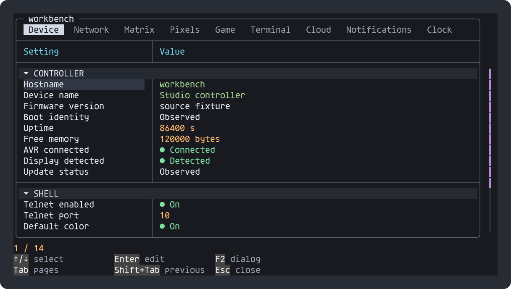
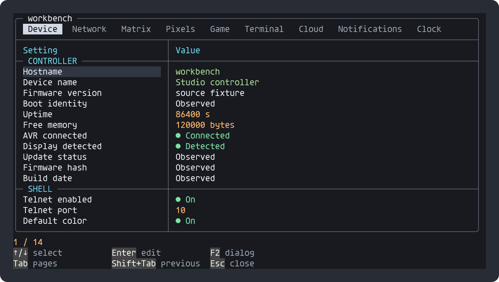
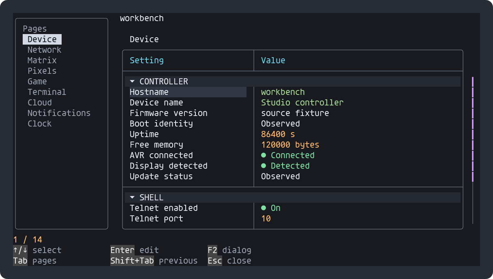
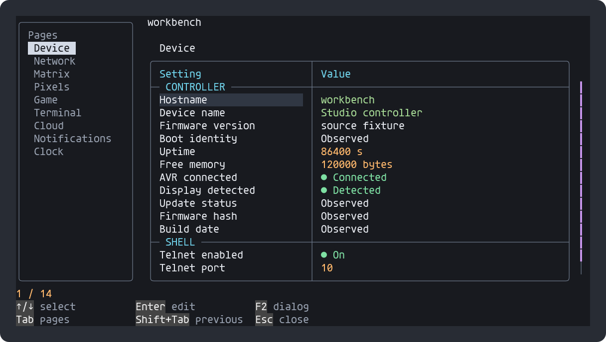
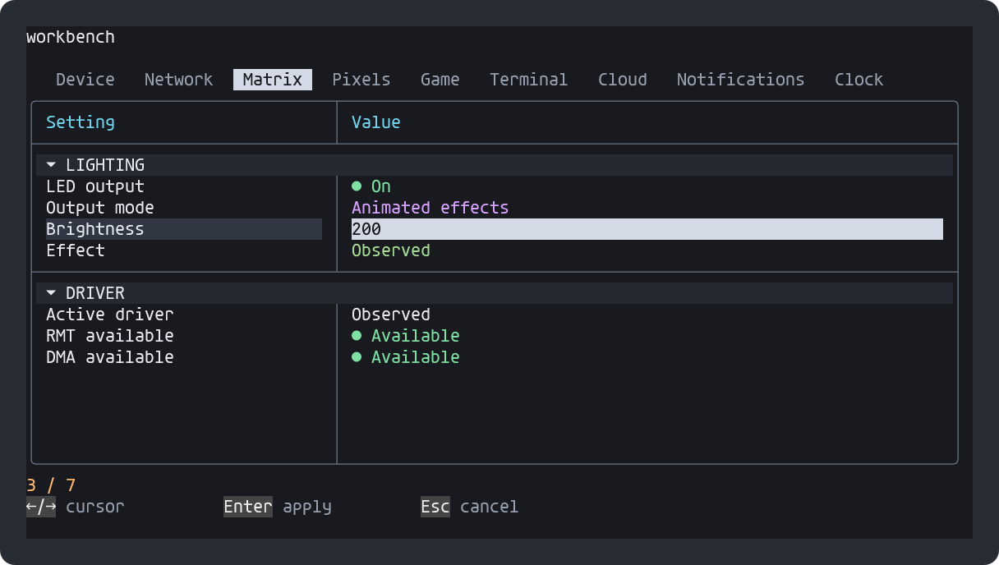
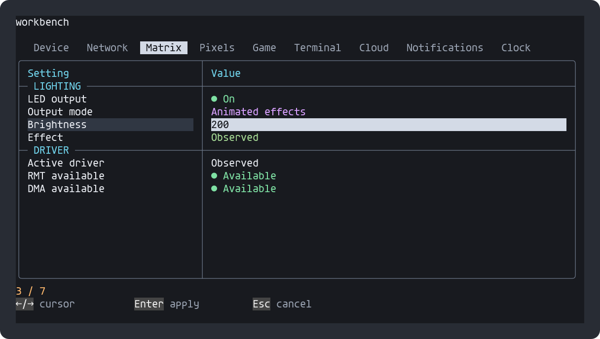
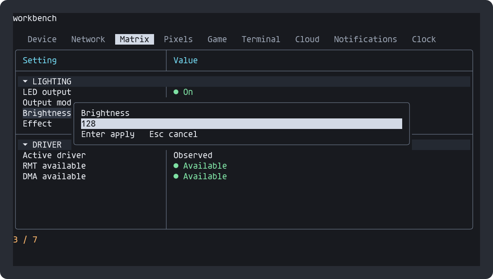
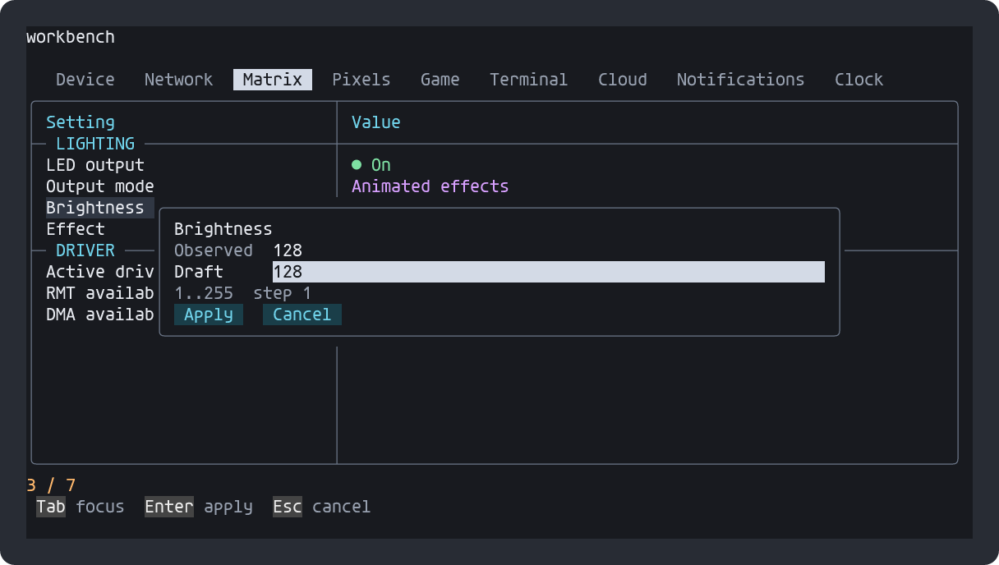
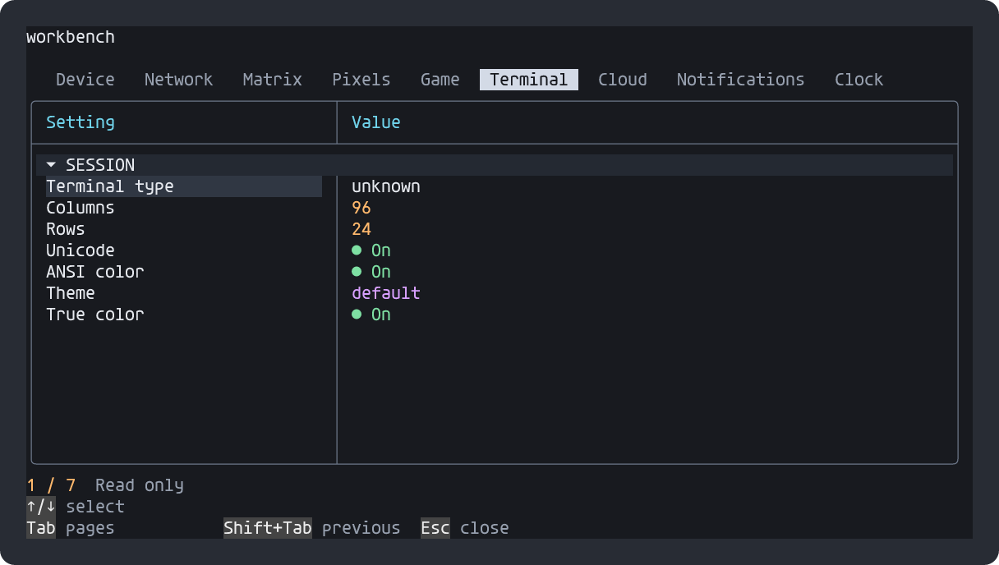
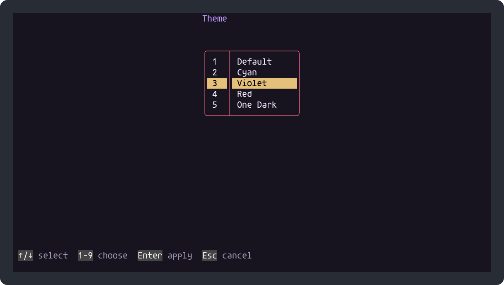

# Firmware terminal: before / after

Actual `ShellTuiBinding.h` bytes, rendered at 96 × 24 with pinned Agave. Values come from deterministic test doubles, not a connected board. Before component: `3a7eeba`; after component: `6d07087`.

[Open side-by-side gallery](index.html) · [Integration guide](../../TERMINAL-UI.md)

## Horizontal tabs inside the frame

Border-integrated group titles replace separate shaded category rows.

| Before | After |
|---|---|
|  |  |

## Vertical navigation

Same setting model, with a separate page column and full-height table.

| Before | After |
|---|---|
|  |  |

## Inline value editing

Edit in the value cell; Enter validates and applies, Esc discards the draft.

| Before | After |
|---|---|
|  |  |

## Observed / Draft dialog

Observed value, editable draft, bounds and step, with explicit Apply and Cancel buttons.

| Before | After |
|---|---|
|  |  |

## Theme selection

Before: a choice value in the settings table. After: a centered numbered picker with rollover and mouse selection.

| Before | After |
|---|---|
|  |  |

## Rebuild

From the Pakar checkout, with GCC on PATH and a PortableShell checkout at the pinned component commit:

```powershell
./tools/render-shell-previews.ps1 -PortableShellRoot /path/to/portable-shell
```

The script runs the normal guarded workspace fixture and reuses PortableShell's C ANSI renderer and pinned Agave/resvg dependencies. Prepare those dependencies using `cmake -DMODE=UPDATE -P tools/rebuild-previews.cmake` in PortableShell if needed. Historical `before-*` captures are retained as the baseline; only `after-*` images are regenerated. PNGs are the distributable previews, with no installed-font requirement. SVGs retain searchable text and require Agave when opened directly.

All nine firmware pages are visited by the fixture. Inline/modal cancellation, validated apply, choice rollover and session-only layout settings are tested. ESP32-S3 compilation and live board acceptance remain separate, unfinished gates. No GPIO, flash, reboot or production connection is performed by this script.
